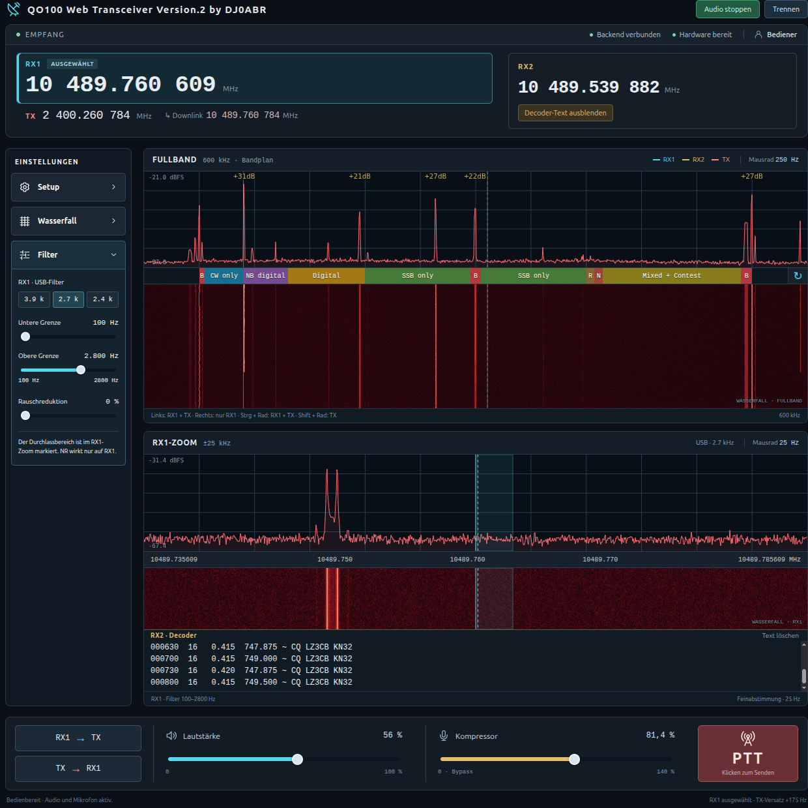
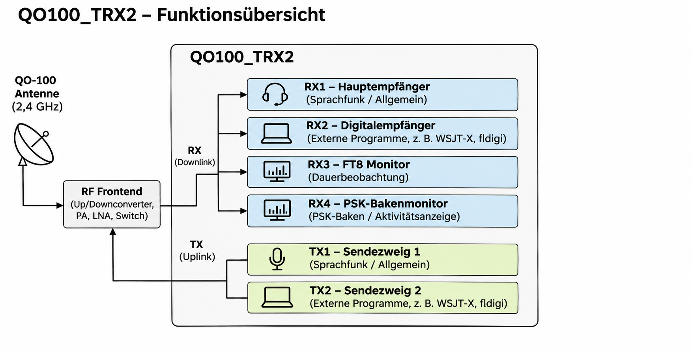
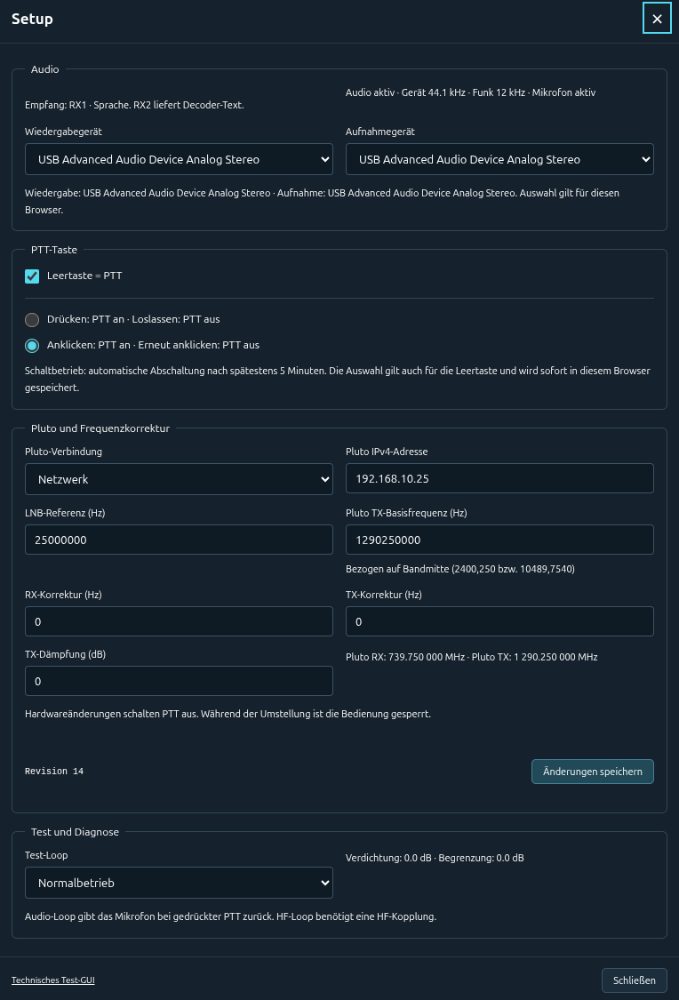
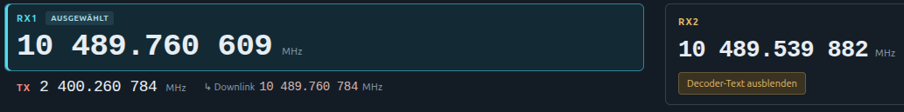
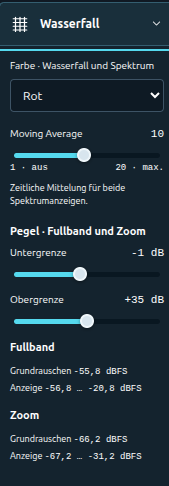
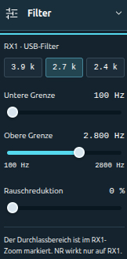
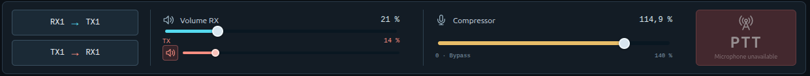
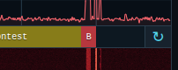
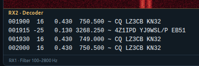

[English](README.md) · [Deutsch](README.de.md)

# QO100_TRX2

QO-100 Software-Transceiver mit einem ADALM-Pluto und einem Einplatinenrechner (SBC), z. B. Raspberry Pi oder Odroid.
Läuft auch auf Desktop-PCs mit einem Linux auf Debian-Basis.
Das Projekt ist ein voll funktionsfähiger Software-Transceiver für QO-100, der im Webbrowser bedient wird.



## Systemübersicht



Ein einzelner Pluto versorgt fünf parallel arbeitende Empfangskanäle und zwei Sendezweige.
**RX1/TX1** dienen dem Sprachfunk im Browser, **RX2/TX2** verbinden externe Digitalprogramme wie WSJT-X oder fldigi über virtuelle Audiogeräte.
**RX3** überwacht FT8 und **RX4** die PSK-Bake auf festen, im Setup einstellbaren Frequenzen; beide Decoder laufen unabhängig vom normalen Funkbetrieb und liefern ihre Texte an das WebGUI.
**RX5** empfängt zusätzlich die Multimedia-Bake und stellt DX-Cluster, CW-Skimmer und Bulletins im WebGUI bereit.
Die beiden Sendezweige werden zu einem gemeinsamen IQ-Signal für den Pluto zusammengeführt.

## Benötigte Hardware

- Pluto SDR, angeschlossen über USB oder einen USB-Ethernet-Adapter.
- SBC wie Raspberry Pi 4, Odroid C4/N2 oder ein Desktop-PC mit Debian, Ubuntu, Linux Mint usw. **Ein 64-Bit-Betriebssystem verwenden.**
- USB-Soundstick, falls der für Audio verwendete Rechner keinen Mikrofoneingang hat. Mikrofon und Lautsprecher/Kopfhörer werden am **Rechner mit dem Browser** angeschlossen.
- Satellitenschüssel, QO-100-Feed/LNB und ein 2,4-GHz-Verstärker, z. B. der 46-dB-Verstärker von AMSAT-DL.

## Installation

Auf dem SBC oder Linux-PC ein Terminal öffnen:

```sh
sudo apt update
sudo apt install -y git
git clone https://github.com/dj0abr/QO100_TRX2.git
cd QO100_TRX2
./build_all.sh --install-deps
```

Das Skript installiert die benötigten Pakete und baut alle Programme. Auf einem SBC werden fehlende Bibliotheken automatisch für dessen Prozessor gebaut.
Für spätere Builds genügt `./build_all.sh`.

### Pluto über Ethernet

- Einen Pluto-kompatiblen USB-Ethernet-Adapter über ein **USB-OTG-Kabel** anschließen. Die **5-V-Versorgung** erfolgt über ein OTG-Y-Kabel oder die separate Strombuchse des Pluto.
- In der Pluto-`config.txt` unter `[USB_ETHERNET]` **`ipaddr_eth` leer lassen**, damit der Router die IP per DHCP vergibt. Nach Änderungen das virtuelle USB-Laufwerk sicher auswerfen.
- Die IP im Router nachsehen, möglichst per DHCP-Reservierung festhalten und unter **Setup → Pluto-Verbindung: Netzwerk** als Pluto-IP eintragen.
- **Adresskonflikte vermeiden:** USB-Netz des Pluto (standardmäßig `192.168.2.x`) und Ethernet-LAN müssen unterschiedliche Subnetze verwenden.

Details: [AMSAT-DL: Pluto im Netzwerk](https://wiki.amsat-dl.org/doku.php?id=de:tricks:pluto_network).

## Software starten

Im Projektverzeichnis:

```sh
./start_all.sh
```

Die Bedienoberfläche im Browser öffnen:

- **Auf demselben Rechner:** <http://localhost:8080/>
- **Von einem anderen Rechner:** `http://<SBC-IP>:8080/` oder die HTTPS-Adresse des Reverse-Proxys.

**Mikrofonzugriff von einem anderen Rechner erfordert HTTPS; auf localhost funktioniert auch HTTP.**
Das Terminal offen lassen. **Strg+C** beendet alle Programme.

## Konfiguration

1. Das GUI verbindet sich automatisch. Falls getrennt, auf **Verbinden** klicken. Auf die Anzeige **Backend verbunden** achten.
2. **Setup** öffnen: USB oder Netzwerk/IP für den Pluto wählen, LNB-Referenz (normalerweise 25 MHz), RX-/TX-Korrekturen und TX-Dämpfung passend zur Station einstellen. Auf **Änderungen speichern** klicken und auf **Hardware bereit** warten.
3. Auf **Audio starten** klicken und den Mikrofonzugriff erlauben. Bei Bedarf unter **Setup → Audio** die Geräte für Wiedergabe und Aufnahme wählen.


<details>
<summary>Setup anzeigen</summary>



</details>

Der erste Browser erhält die Steuerung; weitere Browser können zuschauen und mithören. Die Verbindung bleibt auch ohne Bedienung bestehen. PTT wird nach spätestens fünf Minuten automatisch ausgeschaltet.

## Bedienung

### Die beiden Wasserfälle

**Fullband** zeigt den gesamten QO-100-Schmalbandtransponder. **Zoom** zeigt zur Feinabstimmung ±25 kHz um den ausgewählten Empfänger. **RX1** oder **RX2** anklicken, um das zugehörige RX/TX-Paar auszuwählen; Zoom und Audio folgen der Auswahl.

### Abstimmen mit der Maus

Funktioniert im Spektrum und im Wasserfall:

| Aktion | Wirkung |
|---|---|
| Linksklick | Den ausgewählten Empfänger und seinen TX um denselben Betrag verschieben; der Versatz bleibt erhalten. |
| Rechtsklick | Nur den ausgewählten Empfänger abstimmen. |
| Mausrad | Den ausgewählten Empfänger abstimmen: 250-Hz-Schritte im Fullband, 25 Hz im Zoom. |
| Strg + Mausrad | Den ausgewählten Empfänger und TX gemeinsam verschieben. |
| Umschalt + Mausrad | Nur TX abstimmen. |

Ein Doppelklick auf eine RX-Frequenz öffnet die direkte Frequenzeingabe; für TX genügt ein Klick auf die TX-Frequenz.

Rechts neben der Downlink-Anzeige steht die Downlink-Frequenz unter dem Mauszeiger. Die Anzeige funktioniert über Spektrum, Wasserfall und Frequenzachse im Fullband sowie im RX1-/RX2-Zoom.



### Menü Wasserfall

Farbe, Spektrumglättung (**Moving Average**) und Anzeigepegel wählen. Größere Mittelungswerte ergeben ein ruhigeres Spektrum, kleinere reagieren schneller. **Untergrenze/Obergrenze** so einstellen, dass der Wasserfall gut erkennbar ist.



### Menü Filter

Eine Bandbreitenvorgabe für RX1 wählen oder **untere und obere Filtergrenze** getrennt einstellen. Der Durchlassbereich ist im RX1-Zoom markiert. **Rauschreduktion** verringert das Audiorauschen; mit einem niedrigen Wert beginnen und nach Gehör erhöhen.



### QSO-Bedienelemente

- **RX1 → TX:** TX auf die zu RX1 passende Uplinkfrequenz setzen.
- **TX → RX1:** RX1 auf die zu TX passende Downlinkfrequenz setzen.
- **Lautstärke RX:** Wiedergabelautstärke bei Empfang. Der kleinere rote **TX-Regler** darunter bestimmt die Empfangslautstärke während TX1-PTT, standardmäßig stumm. Das Lautsprechersymbol daneben schaltet auf 0 und beim nächsten Klick auf den vorherigen TX-Wert zurück. Die TX-Mithörlautstärke wird in diesem Browser gespeichert.
- **Kompressor:** hebt die mittlere Sprachlautstärke an. **100 %** ist der normale Ausgangswert; **0 %** schaltet den Kompressor aus.
- **PTT:** Zum Senden die Taste gedrückt halten. Unter **Setup** lassen sich alternativ Ein-/Ausschalten per Klick und optional die Leertaste aktivieren.



### Bandplan und Frequenzanzeige

Der Bandplan zeigt die Bereiche für die verschiedenen Betriebsarten. Mit **↻** rechts an der Fullband-Skala zwischen Bandplan, Downlink-, Uplink- und Pluto-Frequenzen wechseln.



## Fünf Empfänger

- **RX1:** normaler QO-100-Sprechfunk mit einstellbarem Audiofilter und Rauschreduktion.
- **RX2/TX2:** unabhängiges Digitalpaar für FLdigi/WSJT-X mit virtuellen Audiogeräten und zusätzlicher RX2-Audiokontrolle im Browser. [Einrichtung und Pegel](docs/digital-audio.md).
- **RX3:** FT8-Monitor.
- **RX4:** PSK-Bakenmonitor.
- **RX5:** Multimedia-Bakenmonitor mit automatischer Frequenznachführung (AFC), DX-Cluster, CW-Skimmer und Bulletins. Vorgabe: **10489993000 Hz**. [Details](docs/mm-beacon.md).

**Anmerkung zu RX2 in WSJT-X:** Unter **Einstellungen → Audio** folgende Geräte wählen:

| Einstellung | Gerät |
|---|---|
| Input (Eingang) | `fromQO100` |
| Output (Ausgang) | `toQO100` |

Die Namen gelten aus Sicht des Digitalprogramms: `fromQO100` liefert das Empfangsaudio von RX2, `toQO100` führt das Sendeaudio zu TX2. WSJT-X zeigt zusätzlich interne Anschlüsse wie `fromQO100_internal.monitor` und `toQO100.monitor` an. Für den Betrieb über RX2/TX2 die oben aufgeführten Geräte verwenden. Nach dem Update den Stack neu starten und die bisherige Geräteauswahl im Digitalprogramm ersetzen.

Die drei Monitoringfrequenzen unter **Setup → Monitoring-Empfänger** als ganze Hz einstellen und speichern. Oben in der Zoom-Kachel wählen sieben Radiobuttons **RX1-/RX2-Zoom**, **FT8-Monitor**, **PSK-Monitor**, **DX-Cluster**, **CW-Skimmer**, **QO100-Bulletin** oder **RX5-Diagnose**. Die ausgewählte Ansicht nutzt den gesamten Bereich unter den Radiobuttons. Die Zoom-Auswahl folgt dem angeklickten Empfänger RX1/RX2; eine geöffnete Monitoransicht bleibt dabei bestehen. Alle Quellen werden im Hintergrund weiter empfangen und getrennt gepuffert. Ansicht und Lesepositionen bleiben in diesem Browser gespeichert. `./start_all.sh` startet alle drei Decoder. Die MM-Texte und Bulletin-Versionen bleiben in `data/mm-beacon/` über Neustarts erhalten; im Browser erscheinen die letzten 200 DX-/CW-Meldungen und das letzte vollständige Bulletin.



Die ersten Nachrichten erscheinen nach etwa 15–30 Sekunden zuzüglich Rechenzeit. Die Uhr des SBC/PC muss synchronisiert sein.

Technische Einzelheiten stehen in [DEVELOPMENT.md](DEVELOPMENT.md).

PSK-Bakenempfang über RX4: [Kurzanleitung](docs/beacon-decoder.md).
