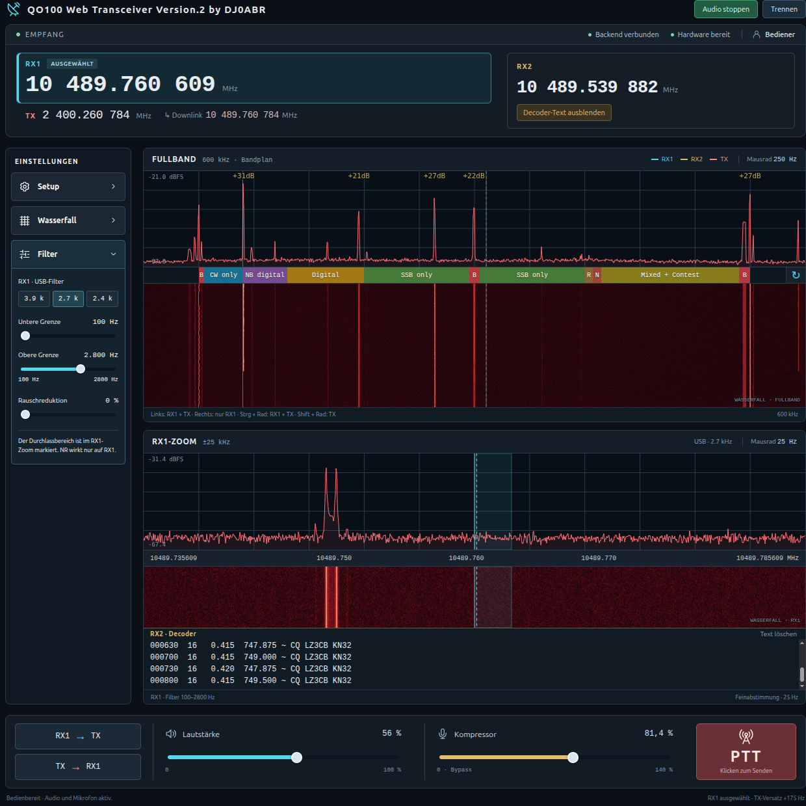
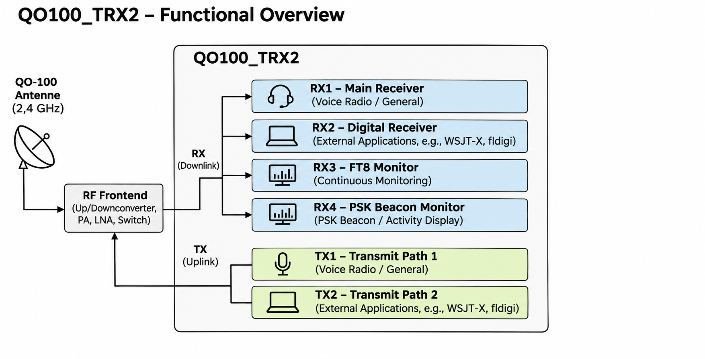
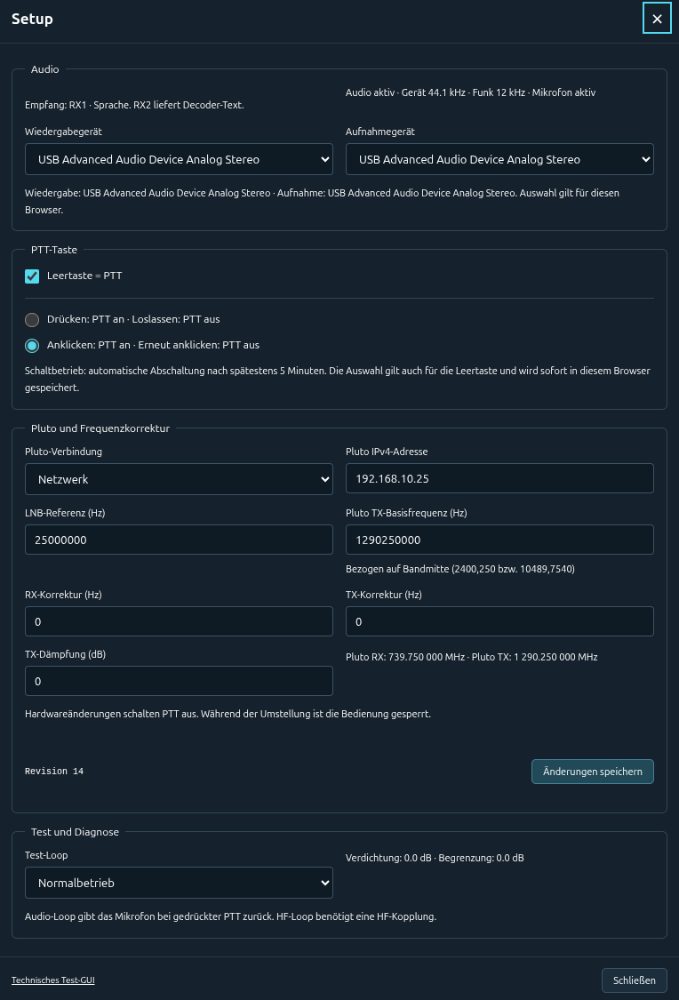
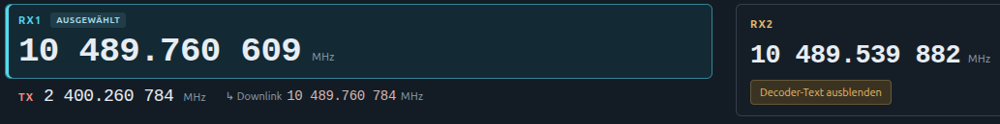
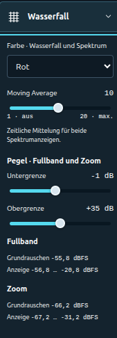
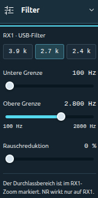
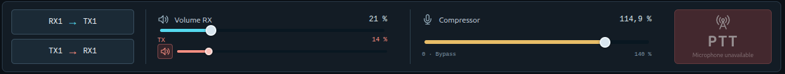
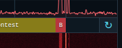
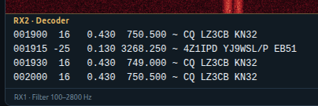

[English](README.md) · [Deutsch](README.de.md)

# QO100_TRX2

QO-100 software transceiver using an ADALM-Pluto and an SBC (Raspberry Pi, Odroid, …).
Also works on Debian-based Linux desktop PCs.
This project is a fully functional software-based transceiver for QO-100, operated from a web browser.



## System Overview



A single Pluto serves five parallel receive channels and two transmit paths.
**RX1/TX1** provide voice operation in the browser, while **RX2/TX2** connect external digital programs such as WSJT-X or fldigi through virtual audio devices.
**RX3** monitors FT8 and **RX4** the PSK beacon on fixed frequencies configurable in Setup; both decoders run independently of normal radio operation and send their text to the WebGUI.
**RX5** additionally receives the multimedia beacon and displays DX cluster, CW skimmer and bulletin text in the WebGUI.
The two transmit paths are combined into a shared IQ signal for the Pluto.

The backend uses three persistent RX workers (RX1, RX2/RX3, RX4/RX5) and one TX worker by default. The main thread handles the shared FFT and communication; Linux schedules these tasks across the four cores of a Raspberry Pi.

For CPU load comparisons, RX2–RX5 and the FT8/PSK/MM decoders can be disabled
individually in [`config/backend.conf`](config/backend.conf). Restart the full
stack after editing; see [DSP threading](docs/dsp-threading.md) for details.

## Hardware Requirements

- Pluto SDR, connected via USB or a USB-to-Ethernet adapter.
- **Minimum requirement: Raspberry Pi 4 with 2 GB RAM**, or a comparable SBC (e.g. Odroid C4/N2) or desktop PC running Debian, Ubuntu, Linux Mint, etc. **Use a 64-bit OS.**
- USB sound stick if the computer used for audio has no microphone connector; microphone and speakers/headphones connect to the **browser computer**.
- Satellite dish, QO-100 feed/LNB and a 2.4 GHz amplifier, e.g. the AMSAT-DL 46 dB amplifier.

Reception and actual on-air transmission have been tested on a Raspberry Pi 4 without interruptions.

## Installation

Open a terminal on the SBC or Linux PC:

On minimal Debian without `sudo`, run `apt update` and `apt install sudo` once as
root, grant the normal user access with `usermod -aG sudo USERNAME`, then log in again.
Run the following steps as that normal user.

```sh
sudo apt update
sudo apt install -y git ca-certificates
git clone https://github.com/dj0abr/QO100_TRX2.git
cd QO100_TRX2
./build_all.sh --install-deps
```

The script installs the required packages and builds everything. On an SBC, missing libraries are built automatically for its processor.
For later builds, just run `./build_all.sh`.

The ADI libraries **libiio** and **libad9361** are installed automatically through
the Debian packages `libiio-dev` and `libad9361-dev`; the bundled Pluto driver is
built from source. No separate ADI driver installation is required.
NumPy/SciPy for the decoders and the audio dependencies are included as well.
For RX2/TX2 on a minimal system, the script adds PulseAudio if neither PulseAudio
nor `pipewire-pulse` is present. Existing sound servers are preserved.
After the first installation, log in again and run `./start_all.sh` as the normal
user so that the virtual devices are available in that user's audio session.
Install FLdigi/WSJT-X and a browser separately if needed.

On a minimal system without a desktop, check the audio connection with `pactl info`
before the first start. If the PulseAudio installation added by the script is not
running yet, run `pulseaudio --start` as the normal user, then check `pactl info`
again. No physical sound card is required. Run PulseAudio and the stack as the same
user, without `sudo`.

Without local digital programs, use `./start_all.sh --no-digital-audio`;
browser RX1/TX1 and the three monitoring decoders do not need a sound card in the VM.

### Pluto over Ethernet

**libiio and libad9361** are also required on the backend computer for Ethernet
operation. `./build_all.sh --install-deps` installs them. libiio connects through
`ip:PLUTO-IP` to the IIO service in Pluto's firmware; no additional Pluto kernel
driver or USB passthrough is required in the Debian VM. The VM must be able to
reach Pluto's IP address.

- Connect a Pluto-compatible USB Ethernet adapter using a **USB OTG cable**. Supply **5 V** through an OTG Y-cable or Pluto's separate power connector.
- In Pluto's `config.txt`, leave **`ipaddr_eth` empty** under `[USB_ETHERNET]` to obtain an IP via DHCP. Safely eject the virtual USB drive after editing.
- Find the IP in your router, preferably reserve it via DHCP, and enter it under **Setup → Pluto connection: Network**.
- **Avoid address conflicts:** Pluto's USB network (default `192.168.2.x`) and Ethernet LAN must use different subnets.

Details: [AMSAT-DL: Pluto networking](https://wiki.amsat-dl.org/doku.php?id=de:tricks:pluto_network).

Before the first start, check connectivity with `iio_info -u ip:PLUTO-IP`.
`iio_info` is installed through `libiio-utils`. Background:
[Analog Devices: libiio over USB and Ethernet](https://github.com/analogdevicesinc/libiio).

## Run the Software

From the project folder:

```sh
./start_all.sh
```

Open the GUI in your browser:

- **On the same computer:** <http://localhost:8080/>
- **From another computer:** `http://<SBC-IP>:8080/`, or your HTTPS reverse-proxy address.

**Microphone access and audio playback require a secure browser context:** HTTPS,
`localhost`, or the browser exception for home networks described below.
Leave the terminal open. **Ctrl+C** stops all programs.

### Audio from another device on your home network

When opening `http://<SBC-IP>:8080/`, browsers block microphone access and
AudioWorklet playback by default. Chrome/Chromium and Brave can explicitly allow
this address on a trusted home network, without setting up certificates or an
HTTPS reverse proxy:

1. On the **device running the browser**, open
   `chrome://flags/#unsafely-treat-insecure-origin-as-secure` in the address bar;
   for Brave, use `brave://flags/#unsafely-treat-insecure-origin-as-secure` instead.
2. Under **Insecure origins treated as secure**, enter the complete transceiver
   address including its port, for example `http://192.168.10.152:8080`.
   Replace the example IP with your own server's IP address.
3. Set the option to **Enabled** and restart the browser using **Relaunch**.
4. Open the WebGUI at that address, click **Audio starten** (Start audio), and
   allow microphone access. The microphone and speakers are on the browser device.

Configure this exception in each browser you use; it applies to the entered
address including its port. It does not encrypt HTTP; use HTTPS for access outside
your trusted home network. For browsers without this setting, use the HTTPS address
as well. Background: [Chromium: secure-context exceptions](https://www.chromium.org/Home/chromium-security/deprecating-powerful-features-on-insecure-origins/).

## Configuration

1. The GUI connects automatically. If disconnected, click **Verbinden** (Connect). Look for **Backend verbunden**.
2. Open **Setup**: choose USB or network/IP for Pluto, set the LNB reference (normally 25 MHz), RX/TX corrections and TX attenuation for your station. Click **Änderungen speichern** (Save changes) and wait for **Hardware bereit**.
3. Click **Audio starten** (Start audio) and allow microphone access. Select your playback and recording devices in **Setup → Audio** if needed.


<details>
<summary>Setup screen</summary>



</details>

The first browser gets control; additional browsers can watch and listen. The connection stays open without user activity. PTT turns off automatically after five minutes at the latest.

## Operation

### The two waterfalls

**Fullband** shows the entire QO-100 narrowband transponder. **Zoom** shows ±30 kHz around the selected receiver for fine tuning. Click **RX1** or **RX2** to select its RX/TX pair; zoom and audio follow your selection.

### Mouse tuning

Works in both the spectrum and waterfall:

| Action | Result |
|---|---|
| Left-click | Move the selected receiver and its TX by the same amount, keeping the offset. |
| Right-click | Tune only the selected receiver. |
| Mouse wheel | Tune the selected receiver: 250 Hz steps in Fullband, 25 Hz in Zoom. |
| Ctrl + wheel | Move the selected receiver and TX together. |
| Shift + wheel | Tune TX only. |

Double-click an RX frequency to enter it directly; click the TX frequency for direct TX entry.

The readout to the right of the downlink display shows the downlink frequency under the mouse pointer. It works over the spectrum, waterfall and frequency axis in Fullband and the RX1/RX2 zoom.



### Waterfall menu — Wasserfall

Choose the colour, spectrum smoothing (**Moving Average**) and display levels. Larger averaging values give a steadier spectrum; lower values respond faster. Adjust **Untergrenze/Obergrenze** for a clear waterfall.



### Filter menu — Filter

Choose an RX1 bandwidth preset or adjust the **lower/upper cutoff** separately. The passband is highlighted in the RX1 zoom. **Rauschreduktion** reduces audio noise; start low and increase to taste.



### QSO controls

- **RX1 → TX:** move TX to RX1's matching uplink frequency.
- **TX → RX1:** move RX1 to TX's matching downlink frequency.
- **RX volume:** speaker/headphone volume while receiving. The smaller red **TX slider** below controls receive audio during TX1 PTT and defaults to mute. The speaker button toggles between zero and the previous TX level. The TX monitoring level is saved in this browser.
- **Kompressor:** raises average speech loudness. **100%** is the normal starting point; **0%** bypasses it.
- **PTT:** transmit by holding the button. In **Setup**, you can choose click-on/click-off operation and optionally enable the spacebar.



### Bandplan and frequency display

The bandplan identifies the operating areas. Click **↻** at the right of the Fullband scale to switch between bandplan, downlink, uplink and Pluto frequencies.



## Five Receivers

- **RX1:** normal QO-100 voice operation, with adjustable audio filter and noise reduction.
- **RX2/TX2:** independent digital pair for FLdigi/WSJT-X, with virtual audio devices and additional RX2 monitoring in the browser. [Setup and levels](docs/digital-audio.md).
- **RX3:** FT8 monitor.
- **RX4:** PSK beacon monitor.
- **RX5:** multimedia beacon monitor with automatic frequency correction (AFC), DX cluster, CW skimmer and bulletins. Default: **10489993000 Hz**. [Details (German)](docs/mm-beacon.md).

**Note on using RX2 with WSJT-X:** Under **Settings → Audio**, select these devices:

| Setting | Device |
|---|---|
| Input | `fromQO100` |
| Output | `toQO100` |

The names describe the digital program's perspective: `fromQO100` supplies received audio from RX2, while `toQO100` sends audio to TX2. WSJT-X also lists internal endpoints such as `fromQO100_internal.monitor` and `toQO100.monitor`. Use the devices listed above for RX2/TX2 operation. After updating, restart the stack and replace the previous device selections in the digital program.

Set all three monitoring frequencies in whole Hz under **Setup → Monitoring receivers** and save. Seven radio buttons at the top of the zoom tile select **RX1/RX2 zoom**, **FT8 monitor**, **PSK monitor**, **DX-Cluster**, **CW-Skimmer**, **QO100-Bulletin** or **RX5 diagnostics**. The selected view fills the entire area below the buttons. The zoom choice follows the selected receiver RX1/RX2; an open monitor view stays selected when switching receivers. All sources continue receiving in the background and have separate buffers. The view and reading positions are saved in this browser. `./start_all.sh` starts all three decoders. MM texts and bulletin versions persist across restarts in `data/mm-beacon/`; the browser shows the latest 200 DX/CW messages and the last complete bulletin.



Allow about 15–30 seconds plus decoding time for the first messages. Keep the SBC/PC clock synchronized.

For technical details, see [DEVELOPMENT.md](DEVELOPMENT.md).

PSK beacon reception via RX4: [instructions](docs/beacon-decoder.md).
