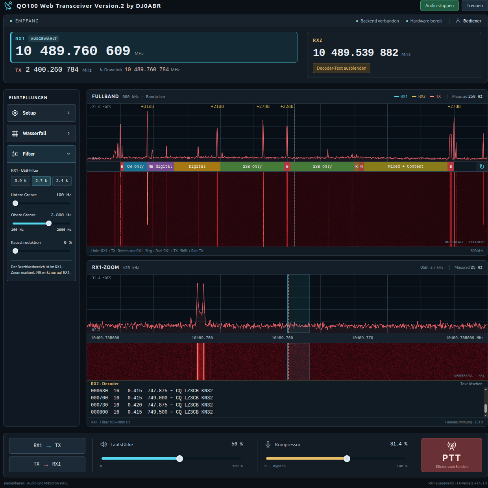

# QO100_TRX2

QO100_TRX2 is a browser-operated software transceiver for the QO-100 narrowband transponder. It uses an ADALM-Pluto with a Raspberry Pi or another Debian-based Linux computer.

## Operating modes

**SSB voice** on RX1/TX1.

Alongside SSB, you can use any one of these fully integrated digital modes on RX2/TX2. No external programs are required for these modes.

- SSTV
- RTTY
- FT4 / FT8
- Waterfall-Text

**[Project wiki](https://github.com/dj0abr/QO100_TRX2/wiki/Home)** · [Wiki auf Deutsch](https://github.com/dj0abr/QO100_TRX2/wiki/Deutsch)

[Start the backend at boot with systemd](README.de.md#automatisch-beim-booten-starten) (German)

